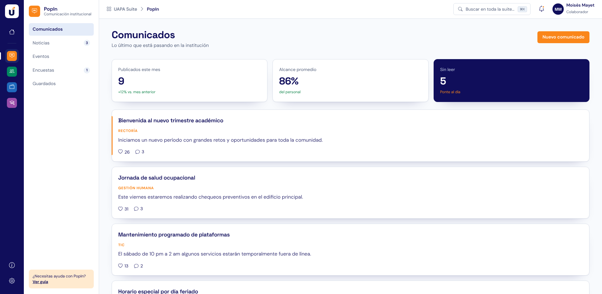
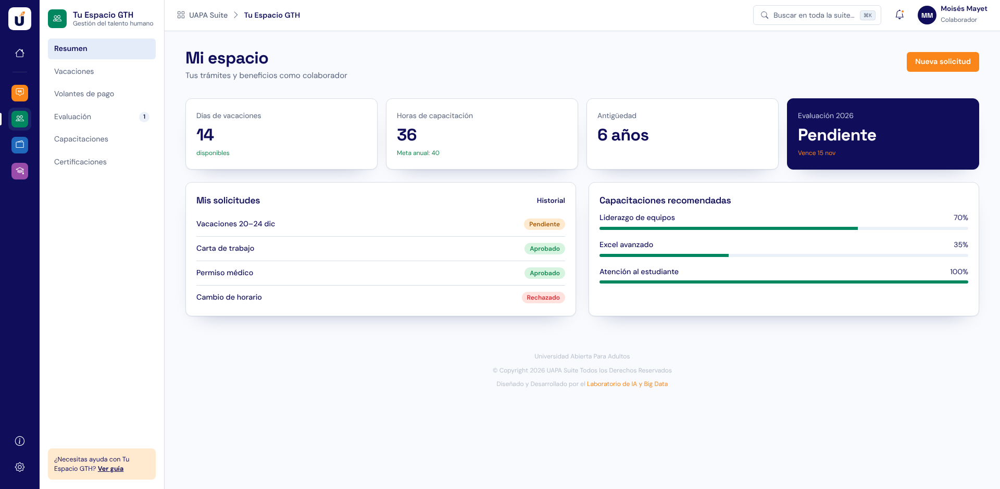
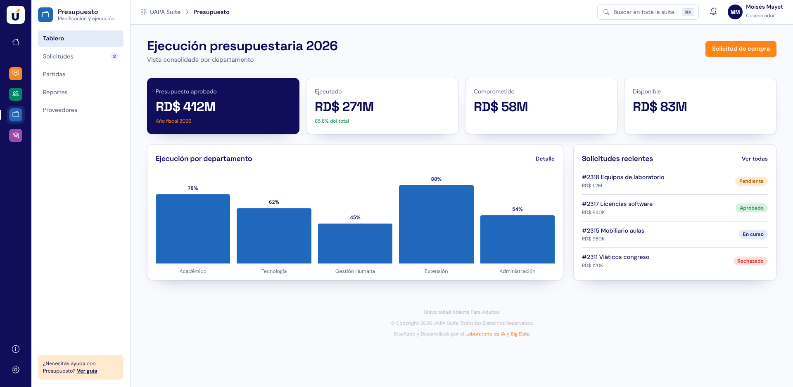
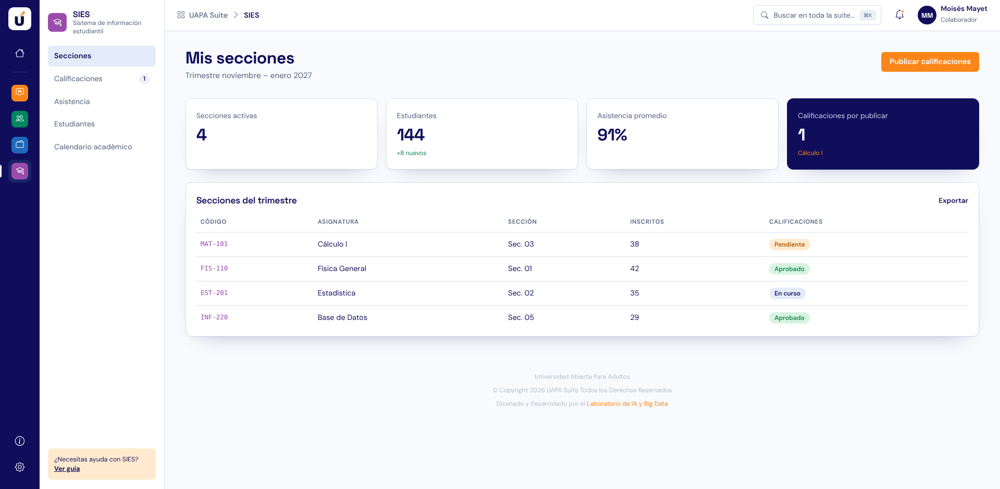

# UAPA Suite

Portal único de la Universidad Abierta Para Adultos (UAPA): **Django 5 · Bootstrap 5 · PostgreSQL**.
Recrea el diseño del prototipo [uapa-one-campus](https://uapa-one-campus.lovable.app) (tokens de color,
tipografías DM Sans / Space Grotesk, sombras y degradados del `styles.css` original, guardado en
`docs/styles-original.css`), con datos reales en PostgreSQL en lugar de contenido fijo.


| PopIn | Tu Espacio GTH |
|---|---|
|  |  |
| **Presupuesto** | **SIES** |
|  |  |

## Qué incluye

- **Portada**: saludo según la hora, aviso institucional, «Mis aplicaciones» (disponibles y «Próximamente»),
  pendientes de la suite y agenda del día.
- **Barra lateral** azul marino con accesos a cada aplicación (en móvil se abre como menú lateral).
- **Búsqueda global** con `Ctrl/⌘ + K` sobre aplicaciones, pendientes y agenda.
- **Notificaciones** (campana con indicador), **pendientes** con filtros y marcado como hecho.
- **Acceso** con usuario y contraseña de Django.
- **Ventana «Info»** (versión y créditos) desde la barra lateral.

### Módulos

Cada aplicación tiene su marco propio: menú secundario con contadores, ruta «UAPA Suite › App», botón de acción,
indicadores (uno resaltado en azul marino) y el recuadro «¿Necesitas ayuda?» con su guía.

| Módulo | Ruta | Qué hace |
|---|---|---|
| PopIn | `/popin/` | Comunicados, noticias, eventos y encuestas; publicados del mes y variación, alcance promedio, sin leer. Me gusta, guardar, comentarios y marcado de lectura. «Nuevo comunicado» requiere el permiso `popin.add_comunicado`. |
| Tu Espacio GTH | `/gth/` | Días de vacaciones, horas de capacitación (ponderadas por avance) frente a la meta, antigüedad, evaluación del año. Nueva solicitud (valida fechas de vacaciones), historial, vacaciones, capacitaciones y evaluación. |
| Presupuesto | `/presupuesto/` | Aprobado, ejecutado, comprometido y disponible; gráfico de ejecución por departamento; solicitudes de compra numeradas (#2319…), con aprobación/rechazo para quien tenga `presupuesto.decidir_solicitudcompra`; partidas con exportación CSV. |
| SIES | `/sies/` | Secciones del docente en el trimestre, estudiantes, asistencia, calificaciones por publicar; «Publicar calificaciones» (todas o por sección) y exportación CSV. |

Las secciones del menú que el prototipo no define (Volantes de pago, Certificaciones, Reportes, Proveedores,
Estudiantes, Calendario académico) muestran «Sección en preparación».

Si una aplicación tiene **URL externa** en el admin, la portada y la barra lateral la abren en otra pestaña;
si la URL está vacía, se usa el módulo interno con el mismo slug.
- **Administración** (`/admin/`) para gestionar aplicaciones, avisos, perfiles, pendientes, agenda y notificaciones.
  Si un perfil tiene aplicaciones asignadas, el usuario solo ve esas; si no, ve todas.

Bootstrap e iconos se sirven desde `static/vendor/` (sin depender de CDN). `static/css/suite.css`
traduce los tokens del diseño a variables de Bootstrap.

## Puesta en marcha

```bash
cd uapa_suite
python -m venv .venv && source .venv/bin/activate
pip install -r requirements.txt
```

Crear la base de datos (ajuste con `.env.example` si usa otros valores):

```bash
sudo -u postgres psql -c "CREATE ROLE uapa LOGIN PASSWORD 'uapa' CREATEDB;" -c "CREATE DATABASE uapa_suite OWNER uapa;"
```

```bash
python manage.py migrate
python manage.py cargar_demo        # usuario mmayet / Uapa-Suite-2026 (admin) + 40 colaboradores ficticios
python manage.py runserver
```

Las variables `POSTGRES_*` y `DJANGO_*` (ver `.env.example`) configuran la conexión y el modo producción.

## Pruebas

```bash
python manage.py test portal
```
