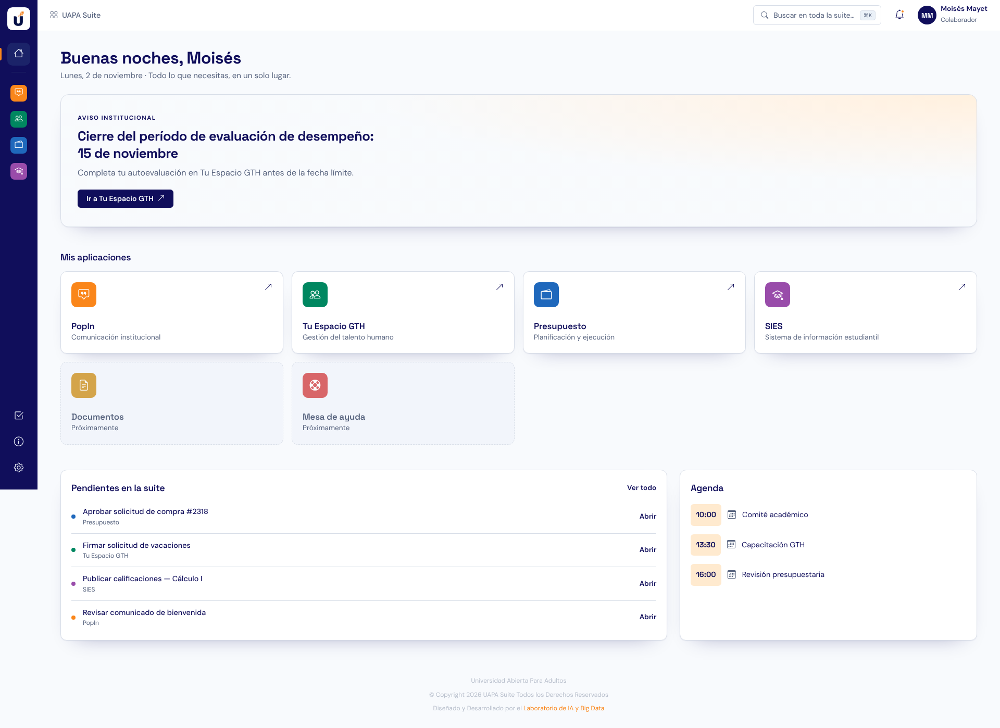

# UAPA Suite

Portal único de la Universidad Abierta Para Adultos (UAPA): **Django 5 · Bootstrap 5 · PostgreSQL**.
Recrea el diseño del prototipo `uapa-one-campus` (tokens de color, tipografías DM Sans / Space Grotesk,
sombras y degradados del `styles.css` original, guardado en `docs/styles-original.css`).



## Qué incluye

- **Portada**: saludo según la hora, aviso institucional, «Mis aplicaciones» (disponibles y «Próximamente»),
  pendientes de la suite y agenda del día.
- **Barra lateral** azul marino con accesos a cada aplicación (en móvil se abre como menú lateral).
- **Búsqueda global** con `Ctrl/⌘ + K` sobre aplicaciones, pendientes y agenda.
- **Notificaciones** (campana con indicador), **pendientes** con filtros y marcado como hecho.
- **Acceso** con usuario y contraseña de Django.
- **Administración** (`/admin/`) para gestionar aplicaciones, avisos, perfiles, pendientes, agenda y notificaciones.
  Si un perfil tiene aplicaciones asignadas, el usuario solo ve esas; si no, ve todas.

Bootstrap e iconos se sirven desde `static/vendor/` (sin depender de CDN). `static/css/suite.css`
traduce los tokens del diseño a variables de Bootstrap.

## Puesta en marcha

```bash
cd uapa_suite
python -m venv .venv && source .venv/bin/activate
pip install -r requirements.txt
```

Crear la base de datos (ajuste con `.env.example` si usa otros valores):

```bash
sudo -u postgres psql -c "CREATE ROLE uapa LOGIN PASSWORD 'uapa' CREATEDB;" -c "CREATE DATABASE uapa_suite OWNER uapa;"
```

```bash
python manage.py migrate
python manage.py cargar_demo        # usuario mmayet / Uapa-Suite-2026 (admin)
python manage.py runserver
```

Las variables `POSTGRES_*` y `DJANGO_*` (ver `.env.example`) configuran la conexión y el modo producción.

## Pruebas

```bash
python manage.py test portal
```
